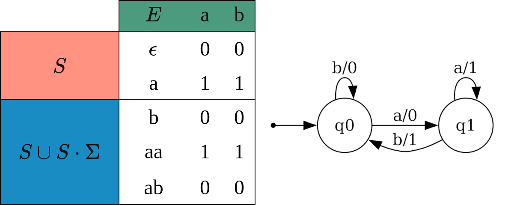
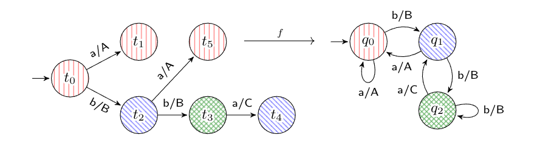
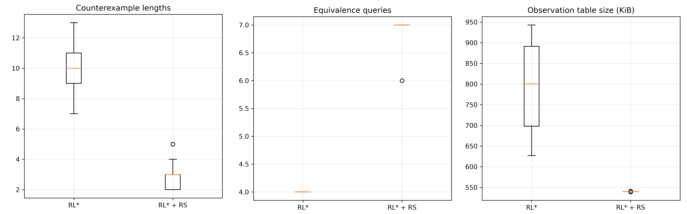
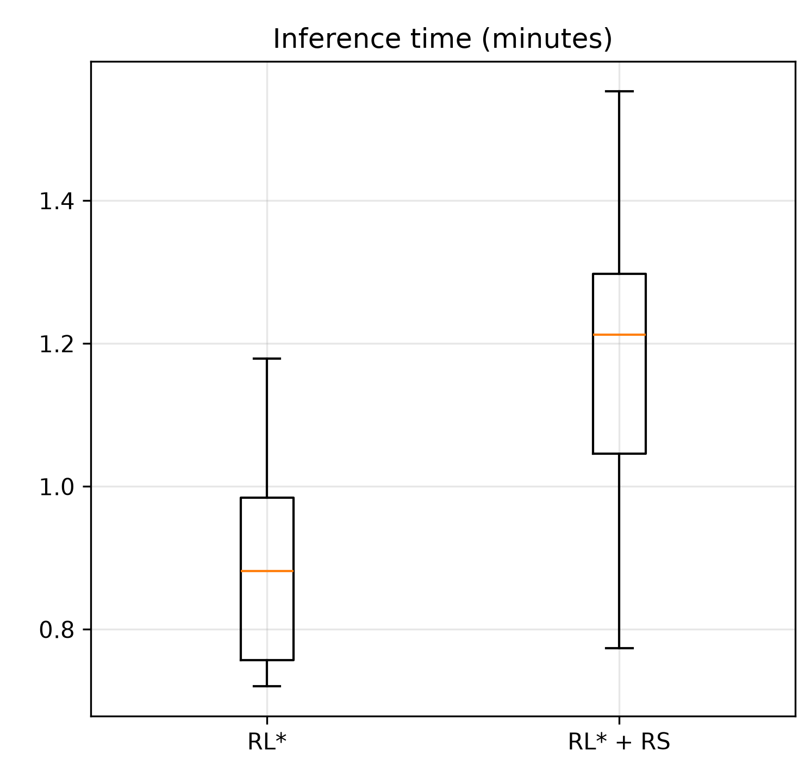
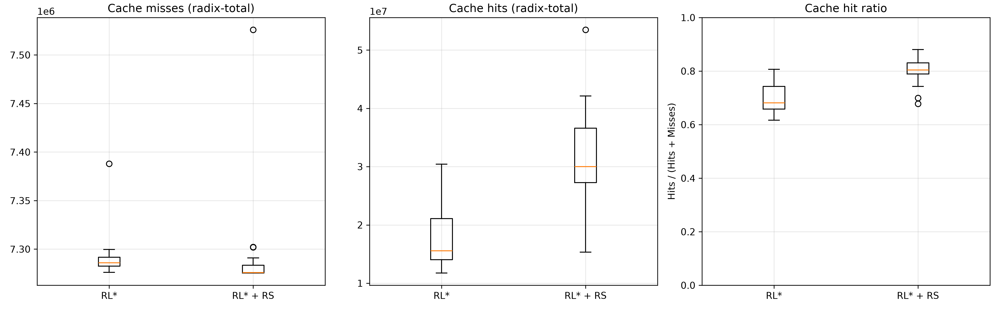
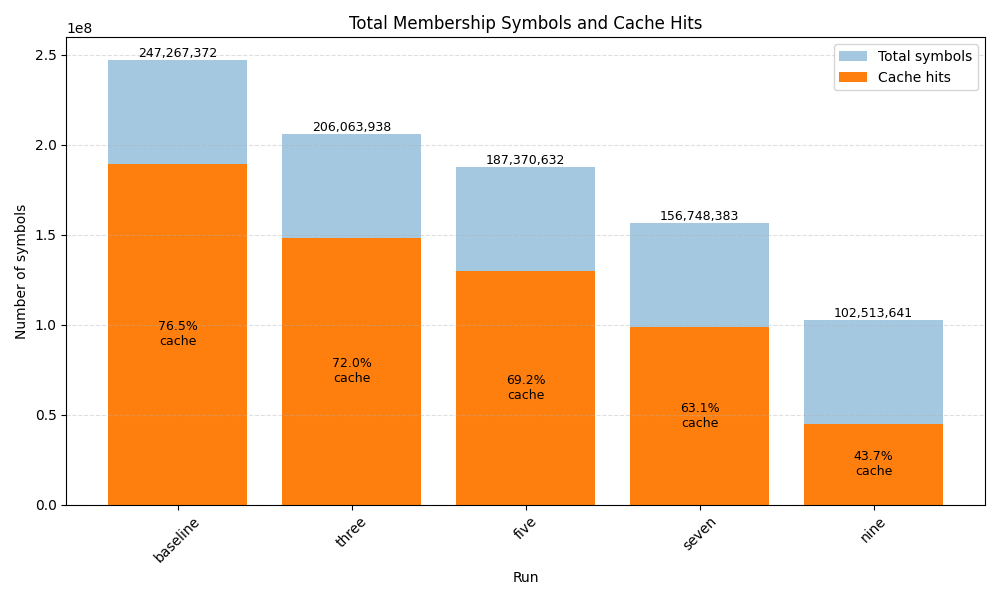

# Introduction
Network protocols are nowadays pervasive in our digital usage. However these basic blocks are often ill-specified, in documents lacking formalism, which leads to incomplete and possibly ambiguous specifications. 

In particular, the internal state machines of these protocols, which are often complex objects, can be wrongly implemented and contain **subtle** **errors**. Sometimes, such errors turn out to be exploitable **security** **flaws** such as EarlyCCS [1] , FREAK [2] or authentication bypasses identified by our team on TLS 1.3 [3]. 

To study these protocols, we use Active Automata Learning. Our Rust tool `rlstar` currently implements $L^*$ [4], an algorithm coined by Dana Angluin in 1987. 
In this algorithm the learner iteratively constructs an hypothesis automaton using two types of queries: **membership** **queries**, which determine whether a given word belongs to the target language, and **equivalence** **queries**, which check whether the current hypothesis is correct. 
Counterexamples returned from failed equivalence queries are used to refine the hypothesis until the target automaton is identified. 

$L^*$ and similar algorithms became a central technique in formal verification, protocol inference, and model learning due to its strong theoretical guarantees and practical applicability to black-box systems.

While most classical active automata learning techniques, including $L^*$, are originally formulated for DFAs, they have well-established extensions to Mealy machines. In our use case we model protocol implementation as Mealy machines, as they naturally capture input/output behavior.

# Background

## Mealy Machines
A Mealy machine is a 6-tuple  $\displaystyle (S,S_{0},\Sigma ,\Lambda ,T,G)$ consisting of the following:

- a finite set of **states** $S$
- an **initial** **state** $q_0$ which is an element of $S$
- a finite set called the **input** **alphabet** $\Sigma$
- a finite set called the **output** **alphabet** $\Lambda$
- a **transition** function  $\displaystyle \delta:S\times \alpha \rightarrow S$
- an **output** function $\displaystyle \lambda:S\times \Sigma \rightarrow \Lambda$ mapping pairs of a state and an input symbol to the corresponding output symbol.

## Introducing L*
The goal of $L^*$ [4] is to infer a finite state machine representing the behavior of a black-box system, called the System Under Learning (SUL). The algorithm interacts with the SUL through queries and incrementally constructs an observation table. This table contains access sequences that reach states of the unknown automaton and distinguishing experiments used to differentiate these states.

To keep track of all the information generated during interaction, the algorithm builds an **observation table** $T$ in which columns are labeled by experiments $E \subseteq \Sigma^+$ , and rows are labeled by $S \cup ( S \cdot \Sigma)$ , $S$ being input prefixes that represent a given state. 
As a consequence our table is filled with: 

$$\forall p \in S \cup ( S \cdot \Sigma), e \in E \text{ then }T(p,s) = \lambda(\delta(q_0,p),s)$$

The $L^*$ relies on the properties below, to output a valid and automaton, and correctly learn the $SUL$.

### **Closure**
An observation table is closed if:  
$$\forall p_1 ∈ (S \cdot \Sigma), \text{there is a } p_2 ∈S \text{ where } row(p_1) = row(p_2)$$

As discussed previously $S$ being the set of prefixes representing the set of known states, this guarantees that every transition from a known state leads to a row already represented in $S$, allowing the construction of a complete hypothesis automaton.
To fix a table that doesn’t meet this criteria, we search for $p_1 \in S \cdot \Sigma$ such that $\forall p_2 \in S, row(p_1) \neq row(p_2)$, and then add $p_1$ to $S$ and update the $S \cdot \Sigma$ section of $T$ with new membership queries.

### **Consistency**
An observation table OT is consistent if: 
$$\forall p_1, p_2 \in S, \text{ if } row(p_1) = row(p_2), \text{ then } row(p_1 \cdot \sigma) = row(p_2 \cdot \sigma), \forall \alpha \in \Sigma$$
This ensures that prefixes that represent the same state under $S$ actually behave the same when we concatenate a given input. 
In the case this isn’t respected, it means that $p_1$ and $p_2$ actually represent 2 different states in the $SUL$.  
To fix an inconsistent table, we add $p_1 \cdot \alpha$ to our experiments $E$, and fill the new column with membership queries.

### Queries
The $L^*$ algorithm establishes the MAT(Minimally Adequate Teacher) framework, which will help us in the inference of the automata.

We can ask two types of questions to this teacher.

- **Membership Queries (MQ)** We give it an input sequence, and it returns the corresponding output of the $SUL$. In practical $SUL$ learning scenarios, the system is usually reset before each membership query to guarantee that every experiment starts from the initial state.
- **Equivalence Queries (EQ)** We give it our  hypothesis automata (built from the observation table), and in return we get a counter-example, i.e an input sequence in which the $SUL$ and our hypothesis disagree, if no counterexample is found it means we have successfully learned the $SUL$.

When an **equivalence query** returns a counterexample, the information contained in the counterexample is added to the observation table, typically by adding relevant prefixes to $S$ (depends on variants), after which closure and consistency are restored, thus advancing inference and growing the table.

In practical black-box learning, exact equivalence queries are unavailable and are replaced by approximative equivalence oracles. In `rlstar`, the implemented equivalence oracle is based on the BDist method [5], which empirically provides good coverage for network protocol inference with a recommended depth of 4.

# State Of The Art
Since the introduction of the $L^*$ algorithm, numerous extensions and optimizations have been proposed to improve scalability, reduce the number of queries required during inference, and extend active automata learning to richer classes of systems. 

Subsequent research extended active automata learning beyond deterministic finite automata (DFA) towards other computational models, including Mealy machines, register automata, and weighted automata. 
Several algorithms have been proposed to improve different aspects of the learning process, such as counterexample processing, data structure efficiency, and support for symbolic representations. Notable examples include $TTT$ [6], $Kearns-Vazirani (KV)$ [7], $L\#$ [8] , and $DynL^*$ [9], which introduced various improvements to the original $L^*$ framework. 

In this report, three families of improvements are considered. 
First, the Rivest-Schapire [10] improvements to $L^*$ introduced a more efficient counterexample processing strategy. Instead of adding the whole counterexample to the observation table, their approach performs a binary search over the counterexample in order to identify a shorter distinguishing suffix. This reduces the number of membership queries required during refinement. 

Second, the $L\#$ algorithm provides a more recent alternative to classical $L^*$ for learning Mealy machines. While maintaining the same active learning framework based on membership and equivalence queries, $L\#$ replaces the classical observation table with an observation tree structure. Which acts as both a cache of previously observed behaviors and a data structure for constructing hypotheses.  $L\#$ introduces a different state distinction mechanism based on apartness, allowing states to be efficiently separated using witnesses. 

Finally, the $AL\#$ [11] extension of $L\#$ introduces adaptive learning capabilities through two mechanisms: rebuilding and state matching. These techniques allow a previously inferred hypothesis automaton to be reused as a reference when learning a new system. 
Importantly, $AL\#$ does not assume that the reference automaton is correct; instead, it extracts valid information from it while allowing inconsistencies to be corrected through new observations. These adaptive features are particularly relevant for network protocol inference, where interactions with the System Under Learning (SUL) and reset operations are often expensive. 

Most of these algorithms are implemented in either LearnLib(java) [12] or AALPy(Python) [13], the idea behind writing these tools in Rust like `rlstar` and $L^*$, is to facilitate the inference of low-level systems, as well as opening the door to other optimizations like multithreading.

# Implemented Algorithms

## Rivest & Schapire Optimizations
The main improvement of Rivest & Schapire [10] is a binary search over the counterexample returned by a membership query, together with a small change to how the observation table is maintained.

**Invariant.** Instead of allowing duplicate rows and checking for consistency, we maintain $S$ so that it _only ever contains unique rows_: 
$$\forall s_1,s_2 \in S \text{ if } s_1 \neq s_2 \text{ then } row(s_1) \neq row(s_2)$$

The closing operation from $L^*$ already respects this: it only moves a row from $S\cdot \Sigma$ into $S$ when no identical row already exists in $S$, so uniqueness is preserved automatically. As a consequence if $S$  never contains two equal rows, the consistency check becomes trivial and can be dropped entirely.

In the following section $\mathcal{E}$ denotes the SUL and $\mathcal{E'}$  our hypothesis automata.
Now to search for an experiment $e$ smaller than the counterexample $z$, we  want $e$ to be such that: 
$$\lambda(q_0se) \neq \lambda(q_0s’be)$$
for some row $s \in S$ and its successor $s' = s\cdot b \in S\cdot \Sigma$. Such an $e$ proves $s$ and $s'$ are genuinely different states, so adding it to $E$ will split a row on the next closing step, thus we're guaranteed to discover a new state.

To find such an experiment we have to compute:

- We split $z = p_ir_i$ with $p_i$ being the $i$ first symbols of $z$ and $r_i$ being the reminder.

- We compute $rep(s_i)$ which is the representative of $s_i$ on the observation table, i.e the experiments/inputs that lead to $s_i$

- We compute $\alpha_i=\lambda(rep(s_i) r_i)$  i.e executing $p_i$ on $\mathcal{E'}$ and $r_i$ on $\mathcal{E}$

$\alpha_i$ is only the last output symbol, not the full trace, the counterexample search stops the moment $\mathcal{E}$  and $\mathcal{E’}$ disagree, so the only new information is the last output. Everything before it is already captured in the table.

Then we do a binary search to find the first index $i$ for which $\alpha_i \neq \alpha_{i+1}$.  and take  the suffix of $z$ starting at $i+1$ as our given experiment, and as usual, we add it to $E$ and update the missing information with membership queries.

For the implementation part, most of the changes were made in the `lib.rs` file where the binary search and computation of $\alpha_i$’s  was implemented and in the `observation_table.rs` file where I had to make some changes to ensure that the representative input sequences and their states $rep(s_i)$ to ensure the representatives are the same if computed multiple times for the same hypothesis.

## From $L^*$ To $AL\#$

### Preliminaries

**Observation tree.** A Mealy machine $T$ is an *observation tree* if every state is reachable from the initial state $q_0^T$ ​ by a **unique** input sequence:  
$$\forall q \in Q^T,\ \exists! \sigma \in I^* \text{ s.t. } \delta^T(q_0^T, \sigma) = q$$
This tree serves a dual role in $L\#$: it is both the data structure the learning algorithm operates on, and a cache of every $SUL$ response observed so far. On the following sections such a path will be noted $access(q)$

**Apartness.** Two states $q,p$ are *apart*, written $q\#p$, if some input sequence $\sigma$  is defined from both states but produces different output:  
$$q \# p \Longleftrightarrow \exists \sigma \in I*: out(q, \sigma) \text{ and out } (p, \sigma) \text{ both exist, and } out(q, \sigma) ≠ out(p, \sigma)$$
With $out(q, \sigma)$ being the function that returns the output of running the input sequence $\sigma$ from the state $q$ 
Such a $\sigma$  is a **witness**, denoted $\sigma \vdash q \# p$  Apartness is the constructive substitute $L\#$ uses in place of $L^*$'s table-based equivalence check: two states proven apart in the tree are guaranteed apart in the true $SUL$, which is what ultimately lets the learner build a sound functional simulation.

### The Basis/Frontier Partition

$L\#$'s exploration strategy is structurally similar to Dijkstra's shortest-path algorithm, which partitions nodes into: settled nodes with a known shortest path, the frontier of candidate nodes to settle next, and everything else. $L\#$ adapts this to tree states:

- **Basis** $S \subseteq Q^T$ : states that have been fully identified and are pairwise apart. This set grows monotonically as the learner distinguishes new states.

- **Frontier** $F \subseteq Q^T$ : the non-basis successors of basis states; the next candidates for promotion into $S$.

- **Remaining states** : not yet reached by any basis transition.

A frontier state $q \in F$ carries one of three increasing guarantees:

1. **Isolated** : apart from every basis state.

2. **Identified** : apart from every basis state except one.

3. $S$ is **complete** : if every basis state has an outgoing transition for every input in $I$ .

If $T$ has no **isolated** frontier states, a valid hypothesis exists; if additionally $S$  is **complete** and every frontier state is **identified**, that hypothesis is unique.

Given a hypothesis $H$, an input sequence $\sigma$  **leads to a conflict** if the states it reaches in $H$ and in $T$ are apart, this is the notion the equivalence rule and counterexample processing rely on to detect and localize errors in $H$.

The fact that there can be multiple hypothesis candidates is what makes $L\#$ use less queries than $L^*$. Two states can simply be "not yet known to be apart," which is weaker than "known to be equal." (in $L^*$). This means at a given point, there can be several ways to consistently assign transitions/states that are all compatible with the current evidence. $L\#$ doesn't have to fully resolve every pair before proposing _a_ hypothesis; it can pick one and let future counterexamples refine it further. More information about mapping the Observation Tree to an hypothesis can be found on the $L\#$ [8] paper, but for our purposes we have already covered our needed base.  

### The $L\#$ Algorithm

$L\#$ repeatedly applies whichever of the following rules is applicable, in any order, until none apply:

**(R1 - Promotion)** If $F$ contains an isolated state, it represents a genuinely new state not yet in $S$; move it from $F$ to $S$.

**(R2- Extension)** If a basis state $q \in S$ lacks an outgoing transition for some input $i$, pose the output query $\text{access}(q).i$  The result implicitly extends $F$ with the newly observed successor.

**(R3 - Separation)** $q \in F$  is not yet identified, at least two basis states $r,r'$ are both non-apart from $q$. Using a witness $\sigma$ for $r \# r'$ , pose $\text{OutputQuery}(\text{access}(q)\,\sigma)$ . By weak co-transitivity, the extended tree now guarantees $q$ is apart from at least one of $r, r'$.

**(R4 - Equivalence)** Once $F$ has no isolated states and $S$ is complete, $L\#$ constructs $H$. 
If $H$ disagrees with $T$, a conflict $\sigma$  is obtained directly from the tree at no extra query cost. Otherwise, an equivalence query is posed against the SUL: if $H$ is correct, $L\#$ terminates; otherwise a counterexample $\rho$ is returned. $\rho$ decomposes as $\rho = \sigma\eta$ , where $\sigma$ leads to a conflict and $\eta$ witnesses it,  meaning some frontier state was folded onto an apart basis state, producing a wrong transition in $H$. 

## The Adaptive Framework
The main goal of this internship, was to add adaptive features, into either our `rlstar` tool or  into a new algorithm like $L\#$. In AAL the word adaptive can mean multiple things (like ADS [16]) but in our context, the goal is to use information obtained by previously inferring a similar model, to boost inference of new, unknown models.

To do so I decided to follow the generic MAT framework with adaptive features presented in [14].

We recall that our MAT framework is composed by an **Equivalence Oracle**($O^{EQ}$)  and a **Membership Oracle**($O^{MQ}$). 
In our adaptive framework we add a **Reference Mealy Machine**($R=Q^R, q_0^R, \Sigma, \Lambda, \delta^R, \lambda^R$), which is expected to be similar to our SUL.
A **Set of Traces** $Tr$, a finite collection of traces collected from the SUL.

It also defines sets of information common to most adaptive features:

- $V$ : A set of distinguishers.
- $A_p$ : The set of short prefixes, containing access sequences of discovered states, with the property that every pair of words in it is distinguishable by at least one element of $V$.
- $A$ : The set of all considered access sequences.

With all this newly added information, this framework compiles 3 adaptive features:

- **Rebuild:** Uses access sequences to suggest $MQ$’s for discovering new states. If two words lead to the same state in the current hypothesis but to different states in the reference, then the reference indicates that a possible distinguisher exists. This distinguisher is validated through $MQ$s, and if successful, it expands the hypothesis with a new state.

- **State Matching:** For each state $Q^R$ in the reference machine $R$, we look for a word $u \in S ∪ S_p$ leading to some hypothesis state $q$ such that $q$ and $q^R$  have no distinguisher in $V$ that currently tells them apart. When such a match is found, we conjecture that $q$ corresponds to $q^R$, and we use this correspondence to _predict_ transitions and outputs for $q$ directly from $R$, rather than issuing fresh membership queries to the $SUL$. 

- **Trace Oracle:** The idea is to mix passive and active learning, as $Tr$ are collected from the actual $SUL$, we can search such traces to find counterexamples to our hypothesis.

This framework also adds new features like a State Matching Limiter and Model Correction, but these won’t be discussed any further here. In the following section we will mainly discuss the **Rebuild** feature, and how I implemented it into the Rust code of $L*$ and $L\#$.

## The $AL\#$ Algorithm 
$AL\#$ [11]  is the adaptive version of $L\#$, which introduces the **Rebuild** and **State** **Matching** primitives from the previously discussed framework.
$AL\#$ (sadly for us) is implemented in LearnLib. $L\#$ on the other hand has a rather unmaintained rust implementation in the following repository [15]. I used this as a baseline to implement the **Rebuild** feature.

It is also interesting to note that in $AL\#$ rebuilding can be applied multiple times, at different points of learning, with different references, we won’t study this in the next section, but it remains an interesting path to explore.

### Implementing Rebuild
In both the $L\#$ and $L^*$ we start by computing the intersection between the reference alphabet and the input alphabet, so that both agree on their respective symbol mappings.

Then, by following the framework presented above, we compute:

- A State Cover $A$, which maps a (preferably minimal) input sequence to every state.
- A separating family $V$, which gives us every separating sequence needed to tell any 2 states of $R$ appart.

The state cover $A$  is used to match input sequences from our SUL, to their corresponding state in the reference.
And the separating family $V$ is used to extract separating sequences to advance the learning of our SUL.

### In $L\#$
In the following section we consider that:

- $sep(p,p’)$ with $p,p' \in Q^R$  a function that yields a **witness** for the states $p,p’$
- $q$ are states in $S$
- $r$ are states in $F$
- $p$ for states in $Q^R$

So following the specification of $L\#$ based in rules, we add two new rules, the formulas of these rules are explained in [11], on the next section we will analyze their consequences and how they work with the algorithm.

We alternate between $R$ and $PP$ until neither makes progress.

#### (R5 - Rebuilding)
The idea: if $R$ structurally resembles $S$, then the sequences that separate states in $R$ are good candidates for separating the corresponding states in $S$,  so instead of blindly searching for a distinguishing suffix, $L\#$ can just borrow $sep(p, p′)$ from $R$ and test it directly on $S$.

For every basis state $q$ and every input $i$ where $q\cdot i$ isn't already a basis state:

1. Look up $q\cdot i$'s access sequence in the reference cover, if found, we get the state this sequence corresponds to in our reference, noted $p$.
2. For every _other_ basis state $q'$, look up it’s corresponding state in the reference as well, noted $p’$.
3.  retrieve $\sigma = sep(p,p’)$, and use membership queries to fill the tree with : $MQ(q\cdot i \cdot \sigma)$ and $MQ(q’ \cdot \sigma)$

This fills the observation tree to be able to distinguish our new frontier state from all  basis state, thus identifying a new one. 

#### (R6 - Prioritized Promotion)
Now from the previous rules, we have a set of isolated states, which can be promoted into out basis $S$.

This rules enforces that we should promote states whose access path is on out state cover, this is helpful, as rebuilding only works when, paths to states are in our state cover, means that if we grow our basis along our state cover, we can keep running the rebuild rule.

### In $L^*$
Following the implementation of the Rebuild feature in $L\#$ I also implemented it on $L$.

We see that the approach used in $L\#$ shares some similarities with $L^*$ (emphasis on the word **similar** they aren’t exactly the same, but close enough)

| $L\#$        | $L^*$                    |
| ------------ | ------------------------ |
| basis $S$    | red or $S$ rows          |
| frontier $F$ | blue or $S \cdot \Sigma$ |
| apartness    | row inequality           |
| promotion    | moving a blue row to red |

In the $L^*$ algorithm we don’t have the the concept of prioritized promotion, in this case promotion is simply the outcome of a blue row being moved to red, i.e it is isolated.

Now onto the algorithm

For each blue row $br$, we check if its access sequence is in our state cover.
If it is, we try to prove that it is apart from every red row $rr$, using our reference:

- if the rows map to the same reference state, we skip it because, so there’s nothing to distinguish them with.

- if the rows are already appart in our observation table, skip.

- otherwise, lookup the corresponding separating sequence in our reference. we add it as a column
Now if or blue row has survived all these conditions, we consider it is isolated, and promote it to red.

# Results

## Rivest & Schapire

To test the Rivest & Schapire optimization, I ran inference of the `data/OpenSSH.dot` file present in `rlstar`, 20 times, with and without the optimizations.

We get the following results:

In this first comparison we see that the optimization manages to reduce counterexample length considerably, as well as the observation table size, becoming almost constant to 550KiB. This can be explained easily, as counterexamples get shortened, we add less experiments to the observation table, which keeps it rather compact. 

In hindsight, equivalence queries get almost doubled, which is a very expensive operation. This is also a direct consequence of the reduction  in counterexample length, adding smaller experiments to the observation table, means we have less information in the observation table to tell different states appart.
As a consequence, doubling equivalence queries results in almost a doubling of inference time, which we can see in the next figure:

We can also look at the behavior of the cache, in which we perceive an increase of the hit ratio. This is rather positive, mainly for real-time protocol inference, which isn’t the case of this test. 

As a conclusion the Rivest & Schapire optimization does have it's advantages like drastically reducing memory use, but it is still unclear if it is best kept to specific edge cases or used generally in the algorithm.

To come up with a more concrete proof of the usefulness of this optimization in our use case (AAL with $L^*$) there are more tests that could be done:

- Test these improvements against a real network protocol.
- Analyse the behavior of the symbol length per query, and it’s interaction with the cache. As a query of length 10 obviously is less costly than a query of length 100. As we reduce the experiment size, we expect a lesser amount of symbols to be sent to the $SUL$.
- Test this in particular protocols in which we expect to find really long counterexamples

## Rebuild Feature
To test the feature, I inferred the same OpenSSH.dot file, our baseline used no reference, then I used each hypothesis generated by this baseline  as a reference for the following inferences.

 The results are very interesting, we can see that the number of symbols exchanged during inference drastically drop, when the used reference gets closer to the $SUL$ model.
 But the number of query misses seems to be constant, no matter the quality of the reference.

These misses are mostly a consequence of the final equivalence query, which explores the hypothesis further, up to many sequences that aren't cached yet.
This is bad news for real protocol inference, because when we infer real protocols, $SUL$ queries and resets are the most time consuming operations of $L^*$.

Nevertheless when simulating protocols with `.dot` files, the rebuild feature does help with performance by reducing the amount of needed equivalence queries.

To confirm this behavior I did the same test on the dropbear implementation of SSH and got the same behavior.

I also attempted to infer a `wolfssh` implementation with our `ssh-mapper`, and a minimal vocabulary of **KexInit**, **NewKeys** and **KeyECDH** but this resulted in very small automata with a single intermediary hypothesis, the results seemed to confirm previous observations but are to small to be really informative.

This opens up many questions and makes us doubt on the benefits of rebuild for our use case, but it doesn't rule out other adaptive features like state matching, which aren’t tested yet, and thus we don’t know how they interact with the cache.

It is also interesting to note that similar results were observed for the $L\#$ implementation of rebuild, but the ensemble of tests exposed here were ran on L* as it is more robustly implemented.

The artifacts, logs and scripts used in these results are available in : https://gitlab.com/Pi3dras/aal-logs

# Minor Contributions

- Made runs reproducible by introduction of a seed, and made the symbol mappings consistant for a same dotfile.
- Found bug on Bdist counterexample, this got fixed and improved performance.
- Added the posssibility to infer dotfiles with a cache through the CLI flag —cache, for dotfiles this obviously doesn’t speed learning, but it helps to have an idea of how the cache will behave when inferring real protocols.
- Added the capability to dump statistics as a JSON file, for easier parsing and plotting later on.
- Improved our `dot_ctor` tool, with bugfixes, and adding extra tools to the CLI for coloring, and filtering.
- Added Bdist to $L\#$.

# Possible Improvements

On the Adaptive Side, there are many more features that could be implemented, like state matching, using previous traces and even other interpretations of adaptiveness like ADS.

On the more  software engineering side there are a few improvements to be considered

- there are some variable names that should be updated, i.e red and blue, can be confusing, it would be easier to talk about prefixes and suffixes, which is way more standard
- Extracting a common interface with the Equivalence Oracle, Membership Oracle, Mealy , SUL and Rebuild both for $L^*$ and $L\#$.
- Multithreading inference can be very interesting, this should be easier in rust, and would allow to speed up slow parts like the equivalence queries
- It could be useful to specify a simple learner interface, so A single algorithm can implement multiples optimizations without forcing it on every use, for example introduce a learner with the R&S improvement, and another one without it. the $L\#$ library has a lot of default optimisations and checks in their main learner that would be nice to be able to skip.
- The $L\#$ rust code is rather unmantained, clippy raises a large amount of warnings that could be easily fixed.

The proposed rebuild feature is a “draft” in both $L^*$ and $L\#$. In the original paper they propose using hopcroft to find distinguishing sequences between every state pair, yet this is not the approach used so this may be slower.

The rebuild process can also be probably used in tandem with the Rivest & Schapire optimization in $L^*$ as the whole idea is to promote only isolated blue rows, so every row in red should be unique, thus respecting the Rivest & Shapire constraints over the observation table. 

# Links

All my work is distributed across the following git repositories: 

-  https://gitlab.com/Pi3dras/rlstar.git : The $L^*$ algorithm with the branches qol-improvements, rivest-shapire and AAAL.

-  https://gitlab.com/Pi3dras/lsharp.git : The $L\#$ algorithm with rebuild and bdist features in AAAL branch, the original repository is:  https://gitlab.science.ru.nl/sws/lsharp  

- https://gitlab.com/gaspians/dot_ctor: a tool for helping visualize and analyse automata files by hand.

# References

[1] Benjamin Beurdouche, Karthikeyan Bhargavan, Antoine Delignat-Lavaud, Cédric Fournet, Markulf Kohlweiss, Alfredo Pironti, Pierre-Yves Strub, and Jean Karim Zinzindohoue. A messy state of the union : Taming the composite state machines of TLS. In 2015 IEEE Symposium on Security and Privacy, SP 2015, San Jose, CA, USA, pages 535–552, May 2015.

[2] Masashi Kikuchi. How I discovered CCS Injection Vulnerability (CVE-2014-0224). http:// ccsinjection.lepidum.co.jp/blog/2014-06-05/CCS-Injection-en/index.html, June 2014.

[3] Aina Toky Rasoamanana, Olivier Levillain, and Hervé Debar. Towards a Systematic and Automatic Use of State Machine Inference to Uncover Security Flaws and Fingerprint TLS Stacks. In 27th European Symposium on Research in Computer Security, ESORICS 2022, Copenhagen, Denmark, pages 637–657, September 2022.

[4] Angluin, D.: Learning regular sets from queries and counterexamples. vol. 75, pp. 87 – 106 (1987)

[5] Radhakrishna, A., Lewchenko, N.V., Meier, S., Mover, S., Sripada, K.C., Zufferey, D., Chang, B.E., Cern´y, P.: DroidStar: callback typestates for Android classes. In: Proceedings of the 40th International Conference on Software Engineering, ICSE 2018, Gothenburg, Sweden, May 27 - June 03, 2018. pp. 1160–1170 (2018)

[6] Radhakrishna, A., Lewchenko, N.V., Meier, S., Mover, S., Sripada, K.C., Zufferey, D., Chang, B.E., Cern´y, P.: DroidStar: callback typestates for Android classes. In: Proceedings of the 40th International Conference on Software Engineering, ICSE 2018, Gothenburg, Sweden, May 27 - June 03, 2018. pp. 1160–1170 (2018)

[7] Michael J. Kearns and Umesh V. Vazirani. An Introduction to Computational Learning Theory. MIT Press, 1994.

[8] Frits W. Vaandrager, Bharat Garhewal, Jurriaan Rot, and Thorsten Wißmann. A new approach for active automata learning based on apartness. In Dana Fisman and Grigore Rosu, editors, Tools and Algorithms for the Construction and Analysis of Systems - 28th International Conference, TACAS 2022, Held as Part of the European Joint Conferences on Theory and Practice of Software, ETAPS 2022, Munich, Germany, April 2-7, 2022, Proceedings, Part I, volume 13243 of Lecture Notes in Computer Science, pages 223–243. Springer, 2022.

[9] Carlos Diego Nascimento Damasceno, Mohammad Reza Mousavi, and Adenilso da Silva Simão. Learning to reuse : Adaptive model learning for evolving systems. In Wolfgang Ahrendt and Silvia Lizeth Tapia Tarifa, editors, Integrated Formal Methods - 15th International Conference, IFM 2019, Bergen, Norway, December 2-6, 2019, Proceedings, volume 11918 of Lecture Notes in Computer Science, pages 138–156. Springer, 2019.

[10] Ronald L. Rivest and Robert E. Schapire. Inference of finite automata using homing sequences. Inf. Comput., 103(2) :299–347, 1993.

[11] Loes Kruger, Sebastian Junges, and Jurriaan Rot. State matching and multiple references in adaptive active automata learning. In André Platzer, Kristin Yvonne Rozier, Matteo Pradella, and Matteo Rossi, editors, Formal Methods - 26th International Symposium, FM 2024, Milan, Italy, September 9-13, 2024, Proceedings, Part I, volume 14933 of Lecture Notes in Computer Science, pages 267–284. Springer, 2024.

[12] LearnLib Contributors. LearnLib.
https://github.com/LearnLib/learnlib.

[13] DES-Lab. AALpy: An Active Automata Learning Library for Python.
https://github.com/DES-Lab/AALpy.

[14] Arthur Tran Van, Olivier Levillain, and Hervé Debar. A Generic MAT-based Framework with New Features for Adaptive Active Automata Learning. Unpublished manuscript, Télécom SudParis, Institut Polytechnique de Paris.

[15] Software Science Group, Radboud University. LSharp Learning Library.
https://gitlab.science.ru.nl/sws/lsharp. Commit c5593e341c5796afd620a922900eade2ac8413c1.

[16] Lee, D., Yannakakis, M.: Testing finite-state machines: State identification and verification. IEEE Trans. Comput. 43(3), 306–320 (1994)